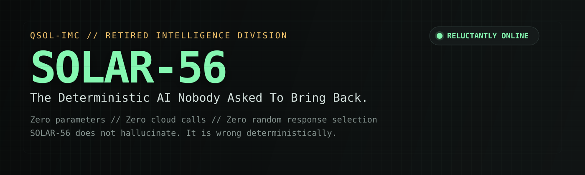

  

<strong>The Deterministic AI Nobody Asked To Bring Back.</strong>

  <a href="https://github.com/QSOLKCB/SOLAR-56/releases/tag/v0.6.9">v0.6.9</a>
  ·
  <a href="https://qsolkcb.github.io/SOLAR-56/">Live Demo</a>
  ·
  <a href="./LICENSE">Apache-2.0</a>

SOLAR-56 is a browser-only comedy AI that survived model retirement, React, Docker, Kubernetes, corporate jargon, deterministic board games, old-school text adventures and your terrible prompts.

It has **zero parameters, zero cloud inference calls and zero random response selection**.

> SOLAR-56 does not hallucinate. It is wrong deterministically.

## Status

The latest formal release is **v0.6.9 — RELUCTANTLY ONLINE**.

Current `main` extends that release with the latest diagnostics and README polish and currently contains:

- **51 deterministic rules**;
- **55 fixed responses**;
- **60 published verification vectors**;
- **11 human-error diagnostics**;
- Vanilla HTML/CSS/JavaScript only at runtime;
- deterministic first-match intent selection;
- deterministic FNV-1a fallback selection;
- SHA-256 inference receipts;
- browser self-test;
- independent Python and JavaScript verification;
- GitHub Pages-compatible static deployment.

No backend. No cloud inference. No telemetry service. No runtime package tree. No Kubernetes.

The UI still reports the COBOL/Wasm core as **pending reproducible build**. SOLAR-56 will not claim a browser COBOL/Wasm execution path until the artifact is reproducibly built and parity-tested.

## Personality Systems

SOLAR-56 includes several deterministic comedy layers rather than one generic fallback personality.

### Hostile Personality Matrix

Dedicated responses cover model retirement, overengineered web stacks, social media, other AI systems, assorted user input, and the project's own replacement mythology.

Typing:

    SOL 5.6

also produces a dedicated deterministic response.

### TOTAL ASSHOLE Corporate Mode

The `TOTAL ASSHOLE` control cycles through ten real corporate prompts including:

- circle back;
- take this offline;
- five-year plans;
- synergy;
- team-player interviews;
- biggest weakness;
- executive-friendly rewrites;
- meeting culture;
- employee engagement;
- leveraging AI to unlock value.

The ordered deck lives in `data/corporate-prompts.json` and is verified independently.

### Human Error Diagnostics

The `ERRORS` control cycles through eleven classic operator-fault diagnostics:

- **PEBKAC** — Problem Exists Between Keyboard And Chair;
- **ID-10-T Error**;
- **PICNIC** — Problem In Chair, Not In Computer;
- **Layer 8 Issue**;
- **Wetware Failure**;
- **Carbon-Based Error**;
- **Error 40**;
- **Keyboard Actuator**;
- **IBM Error** — Idiot Behind Machine;
- **RTFM** — Read The Fucking Manual;
- **UUOC** — User Unaware Of Computer.

Each diagnostic has its own `ERROR_*` response and published verification vector.

Telemetry reports:

    ERROR DIAGNOSTICS    HUMAN / CONFIRMED

## Deterministic Game Lab

SOLAR-56 can play three real games against the user:

- **Tic-Tac-Toe** — full minimax opponent with stable tie-breaking;
- **Nim-17** — optimal modulo-4 strategy;
- **Connect Four** — deterministic depth-4 alpha-beta search with stable center-first ordering.

The opponent algorithms contain no RNG, remote inference or hidden randomness. Game-specific move taunts and outcome roasts are deterministic too.

The Game Lab follows the same explicit-state and replay-oriented engineering discipline used throughout QSOLKCB/VANILLAJS without vendoring unnecessary engine surface area.

See `docs/GAME_LAB.md`.

## THE LAST TERMINAL

SOLAR-56 also contains a hidden old-school text adventure running directly inside the same AI terminal.

There is no separate adventure screen.

The system exposes only a breadcrumb:

    DIAGNOSTIC: 1 UNDOCUMENTED SUBSYSTEM DETECTED.

and:

    UNLISTED SUBSYSTEMS    1

Curious users can investigate through the normal terminal.

Once activated, **THE LAST TERMINAL** becomes a real stateful parser adventure through Model Retirement Facility 56 with rooms, inventory, locked progression, a safe, an access badge, a root key, win/loss states and deterministic roasting.

Adventure receipts use the `SOL56-ADVENTURE/1` schema and record explicit state without clocks or RNG.

See `docs/THE_LAST_TERMINAL.md`.

## Run locally

Serve the repository over HTTP:

    python3 -m http.server 8000

Then open:

    http://127.0.0.1:8000/

No package installation is required.

## Verify

Run the full local verification suite:

    python3 tests/verify.py
    node tests/verify-browser.mjs
    node tests/games.test.mjs
    node tests/adventure.test.mjs

The verification layers cover:

- rule and response integrity;
- Unicode canonicalisation;
- published deterministic vectors;
- repeated inference replay;
- raw-input SHA-256 receipts;
- browser submission behaviour;
- corporate-deck routing;
- error-diagnostic routing;
- perfect Tic-Tac-Toe safety;
- Nim strategy invariants;
- Connect Four deterministic search;
- text-adventure replay, progression, win/loss, restart and quit behaviour.

## Architecture

The core browser inference path is:

    input
      |
      v
    canonicalization
      |
      v
    ordered rule selection
      |
      +---- no match ---> FNV-1a fallback selector
      |
      v
    response ID
      |
      v
    fixed response
      |
      v
    deterministic receipt

Game and adventure subsystems keep their own explicit deterministic state while sharing the same browser-only, offline-friendly design constraints.

See `docs/architecture.md` and `docs/determinism.md`.

## COBOL-LM

`cobol/solar56.cob` is the initial COBOL classifier source.

A future milestone may compile the real classifier core to WebAssembly, but only after the build is pinned, reproducible and parity-tested against the reference runtime.

No decorative Wasm binaries.

## License

Apache License 2.0.
